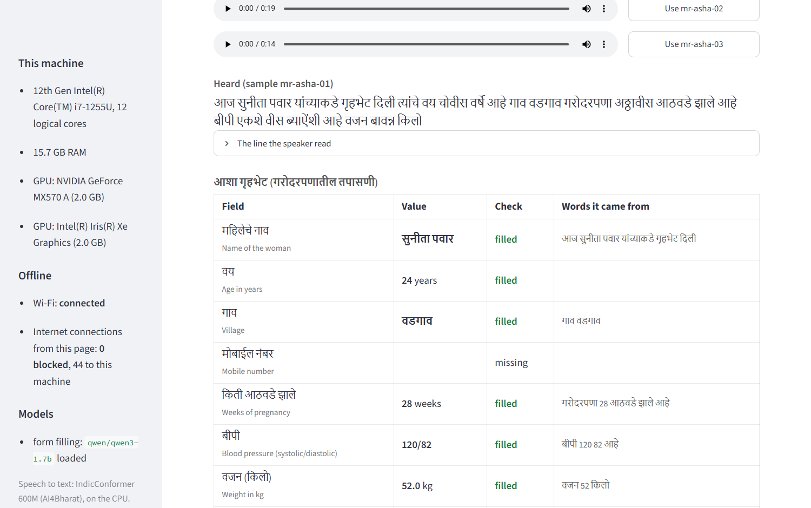

# FrugalAI

> Small is beautiful: useful AI on the hardware people already have.

FrugalAI is a collection of specific, working AI applications and the evidence behind them. Each one runs on the
edge: a plain laptop with no good GPU, a Raspberry Pi or another small board, with no internet needed at run time.
The aim is to address real problems of rural India and of people with the least access, and to make it cheap for
students and small startups to build many more.

## The philosophy

1. **Edge first.** The machine learning, deep learning or small-LLM part must work on a CPU-only laptop, and where
   the job allows it on a Raspberry Pi or a microcontroller. A GPU is never required.
2. **Offline always.** No cloud call at run time. The data stays on the device, which also protects privacy and
   works where connectivity is patchy or absent.
3. **Specific, not generic.** One narrow job for one set of people, done well. Narrow apps need smaller models,
   which saves energy and money and still gives a useful result. A generic assistant is not the goal.
4. **Social problems first.** Farming, health support, schools, village offices, accessibility, small workshops.
   The question for every project is "who is this for, and what does it replace?".
5. **Many small apps.** The repo is a pattern book. Each project is one self-contained folder that can be copied,
   adapted and shipped by a different student or startup.
6. **Measure before claiming.** Every number has a device, a version and a date. If no script produced it, it says
   "pending".

### Use the lowest rung that solves the problem

| Rung | Technique | Typical device |
|---|---|---|
| Rules | Plain code, thresholds, lookup tables | Arduino, Blue Pill |
| Classical ML | Trees, regression, small classifiers on sensor or table data | Raspberry Pi, laptop |
| Small vision | Frozen encoder plus a small head, mobile-class networks, pre-trained hand model | Raspberry Pi, laptop |
| Small speech | Vosk or small Whisper | Laptop, newer Raspberry Pi |
| Small language model | Roughly 0.5B to 4B parameters, quantised, with retrieval | Laptop, newer Raspberry Pi, phone |

### How a project is built

1. Prove it as a proof of concept on a laptop, with a small page (Streamlit or similar) so anyone can try it.
2. Deploy it to the target device. Vision and sensor projects go to a Raspberry Pi. Language projects need a screen
   and keyboard, so they run on a laptop, a larger Pi, or a Pi that serves a local web page to an old phone's browser.
3. Measure speed, memory and, once a meter exists, energy. Record the device in the row.
4. Write the recipe so a stranger can repeat it.

## Projects

Status words: built (code and tests exist), measured (a script produced numbers on a named device), stub (plan and
helpers only).

### Language and speech (proof of concept on a laptop)

| Project | Problem it serves | Status |
|---|---|---|
| [code/wiki-rag/](code/wiki-rag/) | Offline questions and answers over a folder of notes (hand-built BM25 retrieval, own evaluation) | built; retrieval measured |
| [code/quantum-wiki/](code/quantum-wiki/) | Answers with page citations over a course syllabus PDF (Docling, LangChain, Qwen3 1.7B) | built; measured on one machine |
| [code/voice-form/](code/voice-form/) | Speak a form in Marathi or Hindi (ASHA visit, enumeration, service ticket); offline speech to text, plain-code numbers and dates, a small model that must quote its evidence, confirm before save | built; extraction measured on script text |
| [code/workflow-agent/](code/workflow-agent/) | A LangGraph intake workflow with parallel checks, a draft sub-graph and a repair loop, plus a small helpline demo | built; first measurements |
| [code/finetune-slm/](code/finetune-slm/) | LoRA fine-tuning of small models on a CPU: a 135M intent router and a Marathi question-answering study | built; measured, one seed |
| [code/dhir-server/](code/dhir-server/) | How to run the Indian model Dhir 2B (ZenteiQ) from its GGUF file with llama-server, which LM Studio cannot load | recipe; speed, memory and answer check measured |

Each of the first five has a demo page, `app.py`, a small Streamlit page served on the laptop only. Every page shows the
machine (CPU, RAM, the 2 GB MX570), the Wi-Fi state and a counter of blocked internet connections, so the demo can be
run with the Wi-Fi off. Run it from the project folder with `conda run -n genai streamlit run app.py`; each project's
README says which models LM Studio must serve. `_scripts/record_demo.py` records screenshots and a video of a running page.


*Image file: docs/images/frugal_voice_filled.png*

### Vision and sensors (proof of concept on a laptop, deployment on a Raspberry Pi)

| Project | Problem it serves | Status |
|---|---|---|
| [code/gesture-switch/](code/gesture-switch/) | A hand-gesture board for people who cannot speak or type: yes, no or help, driving an LED, buzzer or spoken phrase | stub; laptop proof next, Pi 3 after |

Candidates not yet started, such as a people counter, a leaf check and a cold-chain temperature watch, are listed
with their problem, device and status in [docs/catalogue.md](docs/catalogue.md). Student-sized project ideas with data
and licence notes are in [docs/internship-ideas.md](docs/internship-ideas.md).

### Shared parts

| Area | What it holds | Status |
|---|---|---|
| [code/common/](code/common/) | One small interface over Ollama and LM Studio, plus a benchmark command | working, tested |
| [code/common/benchmarks/](code/common/benchmarks/) | Method and measured results: what runs where | method written, result files |
| [code/common/devices/](code/common/devices/) | Setup notes per device | Dell notes written, not yet measured |
| [code/_template/](code/_template/) | Starting point for a new project folder | ready |
| [_scripts/](_scripts/) | Repo tools: the AWESOME.md checker, a relative-link checker and the demo recorder | working, tested |

### Documents

| File | What it holds |
|---|---|
| [docs/](docs/) | Concepts, landscape, safety, sources |
| [docs/catalogue.md](docs/catalogue.md) | Every project and candidate, by problem, rung and device |
| [docs/hardware-kit.md](docs/hardware-kit.md) | The Raspberry Pi kit we own, what is missing, packaging |
| [AWESOME.md](AWESOME.md) | Curated list of frugal AI efforts by platform (old laptop, Raspberry Pi, phone, microcontroller, browser) |
| [TODO.md](TODO.md) | Open actions |

## What runs where

Numbers appear here only after they are measured and recorded under `code/common/benchmarks/results/`.

| Device | Model (quantisation) | Decode tokens/s | Peak RAM | Date | Notes |
|--------|----------------------|-----------------|----------|------|-------|
| Main PC, Windows, 10 cores, 16 GB (development machine, not a frugal-tier device), CPU only | Qwen3 1.7B (Q4_K_M) via LM Studio | 20.3 median (17.7 to 22.4, n=15) | 2.1 GB (engine only, 2068 MB) | 2026-10-19 | thinking mode on; GPU offload off; only this model loaded |
| Main PC, same, CPU only | Gemma 2 2B (Q5_K_M) via LM Studio | 10.9 median (4.9 to 11.8, n=15) | 3.4 GB (engine only, 3379 MB) | 2026-10-19 | GPU offload off; only this model loaded; the 4.9 minimum is one slow run |
| Main PC, same, GPU-assisted | Qwen3 1.7B (Q4_K_M) via LM Studio | 54.0 median (43.3 to 57.2, n=15) | 2.0 GB (engine only, 1958 MB) | 2026-10-19 | thinking mode on; GeForce MX570 (2 GB) used by LM Studio; only this model loaded |
| Main PC, same, GPU-assisted | Gemma 2 2B (Q5_K_M) via LM Studio | 12.2 median (9.6 to 13.8, n=15) | 2.9 GB (engine only, 2944 MB) | 2026-10-19 | GeForce MX570 (2 GB) used by LM Studio, model only partly fits, so the gain over CPU is small |
| Old Dell laptop (CPU only) | pending | pending | pending | pending | not measured, parked (see "Roadmap") |
| Raspberry Pi 3 Model B (vision, owned) | pending | pending | pending | pending | gesture-switch not yet run on it; frames per second, latency and temperature are the planned columns |

## Outlook

The value here is in the measurements and the finished recipes, not in any single model. Models change
every few months, while the question "what runs on this device, how fast, and is it good enough for this
job" stays, so the method and recipes should outlast them. That makes it a relatively durable and
low-capital direction, with consulting and training as the first way to earn from it and a packaged device
as a later option. The main risks are stale numbers, crowding by runtime vendors, the safety and legal
side of health recipes, weak small-model quality in Indian languages, and one person's time. Nothing here
has been tested with paying users yet. What would raise confidence: measured rows from a second device and a
power meter, and a recipe used by someone other than the author.

## Roadmap

Scope: software and deployment, not chip design. Use an existing runtime (llama.cpp, Ollama, LM Studio, ONNX Runtime,
LiteRT) and measure it. Device ladder: the Pi 3 (owned) runs vision and sensor recipes; language recipes run on a
laptop. Language milestones are parked to 2027, waiting for students and partners.
- Vision on the Raspberry Pi 3: `gesture-switch` from laptop proof to the Pi, then a people counter and a
  cold-chain temperature watch.
- A second device and energy: the same recipe on a second device, with energy per task from a power meter.
- An ASHA-worker assistant in Marathi, Hindi and English: safety framing and an evaluation set first; decision
  support only.
- A phone track: one recipe measured on a real Android phone.
- Later: Modi script OCR, token-frugal prompts measured, frozen encoder plus small head classifiers
  ([docs/internship-ideas.md](docs/internship-ideas.md)).

For the cost side of a token (time, memory, energy), practices to try and how to measure energy per task,
see [docs/token_frugality.md](docs/token_frugality.md). It is a checklist and a plan; this repo has measured
no energy figure yet.

Why frugal AI suits India, with sources for what has been reported, is in [docs/landscape.md](docs/landscape.md).

## Related work

- [AIOOLL](https://github.com/yogeshhk/AIOOLL): AI on an old Linux laptop. A learning and demo toolkit
  (ML, DL, RAG, agents, CV, LLM inference). FrugalAI reuses some of its pieces with attribution and adds
  cross-device measurement.
- [Teaching Data Science](https://github.com/yogeshhk/TeachingDataScience): holds the seminar deck "Frugal AI:
  Small Is Beautiful" (`LaTeX/Main_Seminar_AI_Frugal_*`) and the LangGraph seminar code that runs on a small
  local model through one config file (`Code/langgraph/llm_config.py`).

## Principles for contributors

1. Measure before claiming. Every number has a device, a version and a date.
2. Every factual claim has a source, or is marked "to verify" in [docs/sources.md](docs/sources.md).
3. Offline by default. Data stays on the device.
4. Health-related recipes are decision support only. See [docs/safety.md](docs/safety.md).

## Getting started

```bash
conda env create -f environment.yml
conda activate frugalai                   # on a fresh machine; the author's own env is genai
python -m pytest code -q                  # all tests, offline, no model needed
python _scripts/check_links.py        # relative links in the Markdown files
```

Note: this environment file has not been built or tested yet; the tests and measurements so far ran in another environment (Python 3.10).

Everything that talks to a model needs a local server first: **LM Studio** (local server on port 1234) or
**Ollama** (port 11434), with one small model loaded, for example Qwen3 1.7B at Q4_K_M. Then:

```bash
# benchmark a model on this device (one warm-up, then 5 prompts x 3 repeats; CSV to code/common/benchmarks/results/)
# first make the shared library importable.  PowerShell: $env:PYTHONPATH = "code/common"   bash: export PYTHONPATH=code/common
python -m frugalai_common.bench --backend lmstudio --model <model id> --device <label> --quantisation Q4_K_M

# ask a folder of notes (sample_wiki is made up; index and search need no model)
cd code/wiki-rag
python -m wikirag index sample_wiki
python -m wikirag ask sample_wiki "Which coach and seat is my train ticket for?" --model qwen/qwen3-1.7b --no-think
```

The method and columns of the benchmark are in
[code/common/benchmarks/METHODOLOGY.md](code/common/benchmarks/METHODOLOGY.md). Each project's README has its full
run steps, limits and measured numbers.

## Adding new code or a project

Each project is its own folder under `code/` with its own code, data, tests and README, plus a TODO while an action is open. To add something:

1. **A project** (an end-to-end job): copy [code/_template/](code/_template/) to
   `code/<short-name>/`, give it its own tests and README, and add a row for it to the project tables above and to
   [docs/catalogue.md](docs/catalogue.md).
2. **Shared code** (a new model backend, a metric): put it in [code/common/](code/common/) with an offline
   test, so every recipe can use it.
3. **A measurement:** run the harness and add the CSV under `code/common/benchmarks/results/`, then the row in
   "What runs where". A number goes in only if a script produced it on a named device.
4. **A repo tool:** `_scripts/`. An evaluation set belongs inside the project that uses it.
5. Run `python -m pytest code -q`, `python _scripts/check_links.py` and, if you touched `AWESOME.md`,
   `python _scripts/check_awesome.py`.

## Contributing

Students, startups and practitioners are welcome. See [CONTRIBUTING.md](CONTRIBUTING.md). Easy first
contributions: pick an open candidate from [docs/catalogue.md](docs/catalogue.md), add your own frugal AI effort to
[AWESOME.md](AWESOME.md) (free to use, downloadable model, no token charges), or add measurements from a device you own.

## Licence

MIT, see [LICENSE](LICENSE).
