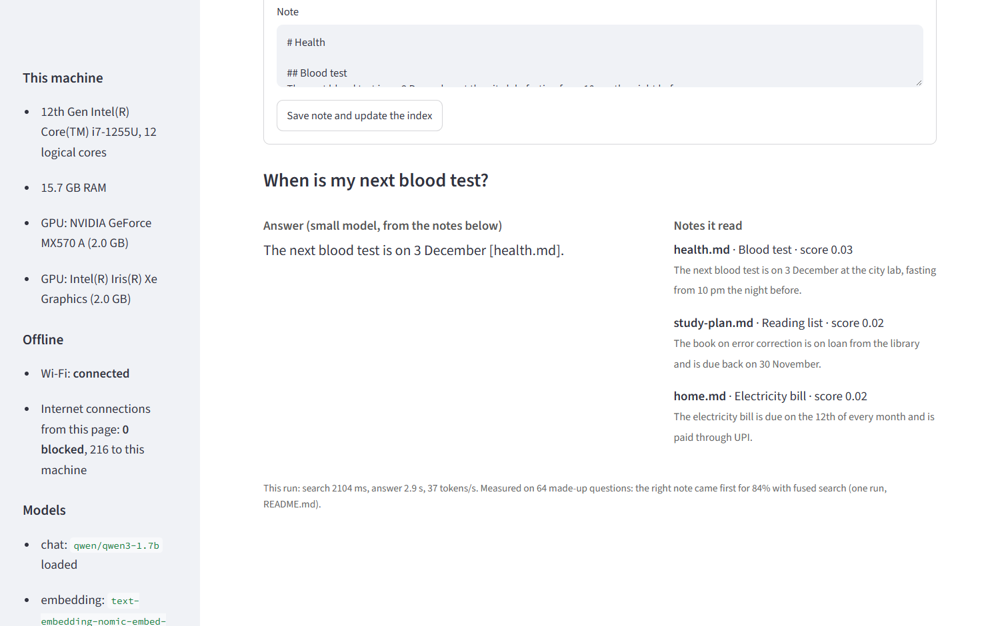

# Recipe: offline wiki Q&A

> Status: built: yes | measured: retrieval yes, answer scoring run once, from `code/dhir-server/` (see its README) | reviewed-by-author: no (the question sets were drafted by Claude)
> | needs LM Studio: only for `ask`, embeddings and answer scoring; `index`, `search`, `eval` and the tests need none

Ask questions of a folder of markdown notes (an Obsidian or Logseq vault, or any folder of `.md` files)
using a small local model. No cloud, and no GPU needed (retrieval is pure Python; the small model runs on a
CPU). The model only sees the few note passages retrieved for each question.

How it differs from the other retrieval project: [`../quantum-wiki/`](../quantum-wiki/) answers questions over one
structured PDF (tables and a topic tree) with plain code first and retrieval only as a fallback, on a LangChain stack. This
recipe is the plain version for any folder of notes: hand-written BM25, no framework, nothing to install beyond the
standard scientific packages. Start here for text notes; start there when the answer sits in a table.

## How it works

1. **Index.** Notes are split by heading and paragraph into chunks of at most 800 characters. A manifest of
   file modification times means only new or changed notes are re-read.
2. **Retrieve.** BM25 ranks chunks by word match. It is pure Python and needs no model, so it costs almost
   nothing on an old laptop. Optionally, embeddings from the backend (for example nomic-embed-text in LM
   Studio) are fused with BM25 by reciprocal rank fusion.
3. **Route.** Plain arithmetic goes to a safe calculator and never reaches the model. Everything else goes
   to retrieval.
4. **Answer.** The top chunks (capped at about 2400 characters) go to a small local model with the rule
   "answer only from the notes, else say you could not find it".

Difference from the original plan: the first sketch used Chroma and sentence-transformers. This version
defaults to BM25 with no extra dependencies, because it is lighter, easier to test and works well for
personal notes. Dense search stays an option. Hindi and Marathi words are tokenised as whole words.

## Demo page
`conda run -n genai streamlit run app.py` from `code/wiki-rag/`, with LM Studio serving Qwen3 1.7B and
nomic-embed-text. The page works on a temporary copy of `sample_wiki/`: ask a question, see the notes it read, or add
a note and ask about it straight away. Arithmetic goes to the calculator route, not the model.

Run the Flet page: `conda run -n genai python app_flet.py` (the same questions and notes, in a desktop window; Flet's window
program is already cached in `~/.flet`, so the first run needs no download). Both pages only draw: `wikirag/core.py`
(class `WikiRag`) does the work, and `config.yaml` chooses the models (`kind: http`, `llama_cpp` or `fake` for the
answer model; `http`, `llama_cpp`, `hash` or `none` for embeddings), the notes folder and top-k. `WIKIRAG_CONFIG` names
another config file.

| File | Role |
|------|------|
| `config.yaml` | choices: notes folder, top-k, answer model, embedding model |
| `wikirag/config.py` | loads the config (env variables `FRUGALAI_*` still win) |
| `wikirag/core.py` | `WikiRag`, the one class the pages and tests use |
| `../common/frugalai_common/embedder.py` | embedding kinds behind one callable (shared by every project) |
| `app.py`, `app_flet.py` | Streamlit page (kept) and Flet page |
| `wikirag/index.py`, `bm25.py`, `router.py`, `answer.py` | index, search, calculator route, prompt |


*Image file: ../../docs/images/frugal_wiki_newnote.png*

## Run it

From `code/wiki-rag/` with a model server running (LM Studio on port 1234, or `--backend ollama`):

```bash
python -m wikirag index sample_wiki
python -m wikirag search sample_wiki "mango watering" -k 2
python -m wikirag ask sample_wiki "Which coach and seat is my train ticket for?" --model qwen/qwen3-1.7b --no-think
python -m wikirag ask sample_wiki "What is 12 * (3 + 4)?" --model qwen/qwen3-1.7b   # calculator, no model call
python -m wikirag watch sample_wiki --interval 5           # re-indexes when notes change
python -m wikirag eval sample_wiki --questions eval/questions.json
```

Add `--embed-model <embedding model id>` to `index`, `search`, `ask` or `eval` to turn on fused dense search.
The index is stored in `<wiki>/.wikirag/index.json` and is safe to delete.

Caveat: `--backend ollama` has never been run against a live Ollama server. The Ollama backend is covered by offline
tests of its reply parsing only; treat it as untested until someone runs it (and reports back).

A question that is plain arithmetic goes to the calculator. A date or an ID written without spaces, such as
`2026-10-19` or `123-456-7890`, is looked up in the notes instead; write `2026 - 10 - 19` to subtract.

## Measured on 2026-10-19 (main PC, LM Studio, Qwen3 1.7B Q4_K_M; not a frugal-tier device)

That PC has a small NVIDIA GPU (GeForce MX570, 2 GB) which LM Studio used for part of the model, so any
speed figure from it is GPU-assisted and not a CPU-only result. The retrieval figures below do not depend on
the GPU.

| Check | Result |
|-------|--------|
| Retrieval, 10 sample questions, BM25 only | hit@1 = 1.00, hit@3 = 1.00 (`results/sample_retrieval.csv`, recomputed 2026-10-25) |
| Retrieval, same questions, BM25 + nomic embeddings | pending (earlier run, no results file kept; needs LM Studio to rerun) |
| Retrieval time per question | under 1 ms (BM25, 6 small notes; the slowest of the 10 questions took 0.39 ms, `results/sample_retrieval.csv`) |
| Grounded answers checked by hand | pending (an earlier hand check; nothing was saved, so no count is given) |
| Dell and Raspberry Pi | not measured yet |

The sample wiki is small, made up and easy, so these numbers show the pipeline works. They do not show
how it performs on a real vault. Build a larger evaluation from your own notes before drawing conclusions.

## Harder evaluation (own questions, own vault)

`eval/build_eval.py` builds `eval/vault/` (8 notes, 32 made-up facts) and `eval/qa.json` (72 questions):
32 **lexical** questions that reuse the note's words, 32 **paraphrase** questions that ask the same thing in
other words, and 8 **unanswerable** ones whose right answer is "not in the notes". Everything is made up, so
the answers are known. Run it from `code/wiki-rag/`:

```bash
python eval/build_eval.py
python -m wikirag bench eval/vault --qa eval/qa.json --embed-model text-embedding-nomic-embed-text-v1.5
python -m wikirag bench eval/vault --qa eval/qa.json --embed-model text-embedding-nomic-embed-text-v1.5 --model qwen/qwen3-1.7b --no-think
```

The first form scores retrieval only (BM25, dense and fused). Adding `--model` also scores the answers: whether
the expected text appears, and whether an unanswerable question gets an honest refusal. Results go to
`results/bench.csv` and `results/bench_answers.json`.

Retrieval, measured on 2026-10-20 on the main PC (k = 3, embeddings from nomic-embed-text-v1.5 served by LM Studio):

| Mode | Lexical hit@1 | Paraphrase hit@1 | Paraphrase hit@3 | All questions MRR |
|------|---------------|------------------|------------------|-------------------|
| BM25 only | 1.00 | 0.22 | 0.34 | 0.64 |
| Dense only | 0.97 | 0.81 | 0.94 | 0.93 |
| BM25 + dense (fused) | 1.00 | 0.69 | 0.91 | 0.91 |

BM25 alone is perfect when the question shares words with the note and weak when it does not, which is the
case for dense search. On this vault, fusing did slightly worse than dense alone on paraphrases (the lexical
side adds noise there); with only 32 paraphrase questions the gap is small, so do not read much into it.
Retrieval time with embeddings was about 2.2 s per question, almost all of it the embedding call to the LM
Studio server while another job was using the CPU, so it is not a clean speed figure. BM25 took under 1 ms.

## Limits

- Retrieval is word-based. A question that shares no words with the right note is missed unless dense
  search is on (the tests show this on a toy example).
- Answers are only as good as the retrieved passages and the small model. Always check the cited source.
- Qwen3 may spend its token budget on hidden "thinking" for open-ended prompts. In this recipe's short,
  grounded prompts we saw none, and `/no_think` made no difference (not reproduced in-repo: no log of that
  comparison), but the `--no-think` flag is there if your model does it. The flag appends `/no_think` to the
  prompt whatever the model is, so use it with Qwen3 only.
- No file watcher dependency: `watch` polls every few seconds, which is enough for notes.

## Tests

```bash
python -m pytest code/wiki-rag/tests -v     # from the repo root; fully offline
```

## Set up and extend
Environment: `environment.yml` here (conda, `frugalai-wiki-rag`; without conda, `requirements.txt`). Ideas for forks: see "Ideas to extend" below.

## Ideas to extend

Ideas for anyone who forks this repo. Pick one, open an issue so two people do not do the same, and send a pull
request. Rules for every idea: never invent a number (a figure exists only if a script produced it on a named
device), keep it offline, and say whether a GPU was used. See `../../CONTRIBUTING.md`.

Size: small is an evening, medium is a weekend, large is a few weekends.

### Run it on a Raspberry Pi or an old laptop (small)
- Retrieval is pure Python and the model is small, but the README says the Dell and the Pi are not measured.
- Do: run `index`, `search`, `eval` and the benchmark runner on your device and add the CSV with the device label.
- Needs: the device and Ollama or LM Studio; `../common/devices/` has the device notes.

### Test the Ollama backend (small)
- `--backend ollama` has only offline parse tests and has never been run against a live server.
- Do: run `ask` and `eval` against Ollama and report what breaks; fix it in the pull request.

### Dense retrieval numbers (small)
- BM25 plus embeddings is listed as pending because no results file was kept.
- Do: rerun `eval` with `--embed-model` and commit the CSV next to `results/sample_retrieval.csv`.

### Your own vault, your own questions (medium)
- The sample wiki is small and made up. Point it at a real vault (kept private), write 30 to 50 questions with the notes you expect, and score retrieval with `eval`.
- Done when: a results file that names the vault size but not its contents.

### Hindi and Marathi retrieval (medium)
- Words are tokenised whole. Add a small stemmer or character n-grams for Devanagari and compare hit@1 and hit@3 on a Marathi question set.
- Needs: a Marathi or Hindi note set and questions you wrote; mark who reviewed them.

### Better chunking for tables and code (medium)
- Notes are split by heading and paragraph into at most 800 characters. Try table-aware and code-block-aware splits and compare on the harder evaluation in `eval/`.

### Grounded-answer check by script (medium)
- Answers are checked by hand and no count is saved. Write a script that checks every quoted passage in an answer exists in the retrieved chunks, and report the count.

### Obsidian plugin or a small web page (large)
- Wrap `ask` in a local page or plugin. It must stay offline and show the source note for every answer.
