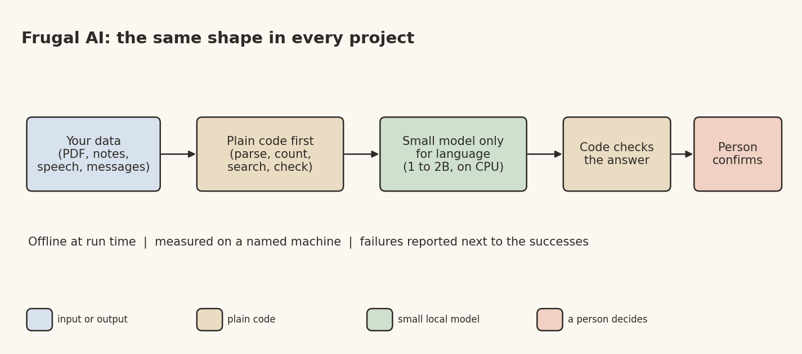

# Small Is Beautiful: Useful AI on the Hardware India Already Has

*Frugal AI series, part 1 of 6. Desi Stack. DRAFT, publish Sun 1 Nov 2026.*

Banner: generate it from the prompt in `01_umbrella_linkedin.md` (title "Small is beautiful"), save it as
`01_umbrella_banner.png` in this folder, and put it at the top here before publishing.

Most AI demos I see make three quiet assumptions. A fast internet connection. A cloud account. And a bill that grows with every question you ask.

Now picture where a lot of India actually works. A zilla parishad school with one shared laptop. An ASHA worker's phone in a village where the signal comes and goes. A college lab full of machines bought five years ago. None of those assumptions hold there.

So I started an open-source repository called Frugal AI, with one question behind it: how much useful AI can you get out of the hardware people already have?

## The rules

Every project in the repo follows the same four rules.

1. **Offline at run time.** Downloading a model once is fine. After that, nothing goes to the internet, so student data, patient data and village data stay on the machine.
2. **Small models, ordinary hardware.** Models of about one to two billion parameters, on a laptop CPU. No GPU required.
3. **Indian languages first.** Marathi and Hindi, because that's who the users are.
4. **Measured, with the failures.** A number appears only if a script produced it on a named machine. When something didn't work, the README says so, in the same table.

The fourth rule turned out to matter most. It's very easy to build a demo that looks clever. It's much harder to show it works on questions you didn't tune it on.

## The same shape, five times

After building a few of these, I noticed they all ended up with the same shape.



*Image file: 01_umbrella_diagram.png*

Plain code does everything code is good at: parsing, counting, searching, checking numbers. A small model does only the language work, where nothing else will do. Code checks what the model said. And for anything that matters, a person confirms before it's saved.

That split is the whole trick. A 1.7-billion-parameter model is a poor calculator and a poor database. It's a decent reader. Give it only the reading, and it does surprisingly well on a laptop.

## What's in the repo

Five projects, each a self-contained folder with its code, data, tests, a README and a TODO:

- **quantum-wiki** answers questions about a 39-page university syllabus PDF, with page numbers. Most answers come from code reading a parsed structure; the model is called for about a third of the questions.
- **workflow-agent** is a LangGraph workflow that decides whether a new concept is already covered in a set of FAQ notes and, if not, drafts an entry. Half of it worked very well. The other half lost to a single plain prompt, and the story of why is the useful part.
- **finetune-slm** fine-tunes small models on a laptop CPU: a 135M-parameter message router, and a study of whether a 1B model can learn a Marathi book. (Retrieval won.)
- **wiki-rag** answers questions from a folder of your own Markdown notes, with a keyword search written in plain Python.
- **voice-form** lets a field worker speak a form in Marathi or Hindi and fills it, with nothing saved until the worker confirms.

Each gets its own story in this series.

## Running it yourself

Everything runs on one laptop. The models are served by LM Studio on the same machine, and Python uses a conda environment.

```bash
git clone https://github.com/yogeshhk/FrugalAI.git
cd FrugalAI
conda env create -f environment.yml
conda activate frugalai
python -m pytest code -q          # offline tests: no model server, no download
```

Each project shares one tiny interface over the local model servers, so a recipe can be measured on Ollama, LM Studio or llama.cpp without changing the recipe:

```python
class Backend(ABC):
    """A local LLM runtime that can generate text."""

    @abstractmethod
    def generate(self, model: str, prompt: str, system: str = "",
                 max_tokens: int = 256, temperature: float = 0.2) -> GenResult:
        """Generate a completion for one prompt."""
```

`GenResult` carries the text plus the timings (time to first token, tokens per second) and says where the timings came from, so a number measured one way is never mixed with a number measured another.

## The honest part

My development machine is a reasonably modern Windows laptop, not the old laptop or Raspberry Pi this is aimed at. The repo says so next to every number, and the "old Dell" and "Raspberry Pi" rows are still marked pending. Several evaluation sets were drafted with an AI assistant and still need review by a person. Those caveats are written into each README, because a frugal approach is only worth something if you can trust its numbers.

## Where you come in

None of these projects is finished, on purpose. Each one ends with a list of open threads: another language, another device, a better evaluation, an Android version.

If you're a student, pick one for an internship or a final-year project. If you're a researcher, there's a lot left to measure about small models in Indian languages. If you're building a startup for a village, a school or a clinic, the hard parts (offline, cheap, Indian languages) are exactly the parts these projects work on.

The repo: https://github.com/yogeshhk/FrugalAI

Next in the series: a syllabus PDF that defeated plain retrieval, and what fixed it.

*Tags: Frugal AI, Small Language Models, Indian Languages, Open Source, Offline AI*
