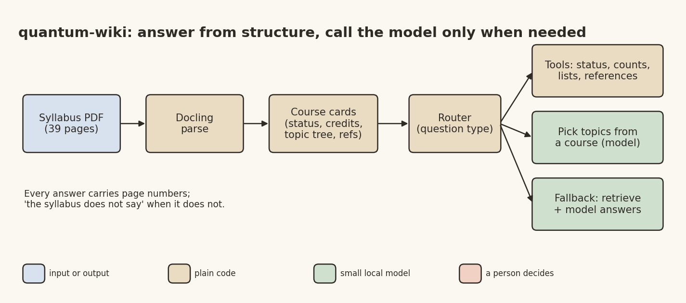

# Ask the Syllabus: When Plain RAG Fails on a PDF, Build Structure Instead

*Frugal AI series, part 2 of 6. Desi Stack. DRAFT, publish Tue 3 Nov 2026.*

Banner: generate it from the prompt in `02_quantum_wiki_linkedin.md` (title "Ask the syllabus"), save it as
`02_quantum_wiki_banner.png` in this folder, and put it at the top here before publishing.

A student opens the AICTE model curriculum for the Minor in Quantum Technologies, a 39-page PDF, and asks a simple question: "Which courses are optional?"

I wanted a small model on a laptop to answer questions like that, with page numbers. My first attempt was the standard recipe, and it taught me something about PDFs.

## Why plain retrieval failed

The usual approach (often called RAG) cuts a document into chunks, finds the chunks closest to the question, and hands them to a model to read. On this syllabus it got 40% of my test questions right.

Looking at the failures, two patterns stood out.

The answer to "which courses are optional" is in no sentence at all. It lives in the spanning header rows of one table on page 14: two courses mandatory, "at least one of" these two, "at least one of" those four, the rest optional. Cut that table into chunks and the structure is gone.

Other questions, like "which courses mention the no-cloning theorem", have answers spread across three courses. Retrieval brings back a few chunks, and the rest of the answer is simply never seen.

So the fix was a change of approach rather than a better retriever.

## The architecture



*Image file: 02_quantum_wiki_diagram.png*

**Parse once, keep the structure.** Docling turns the PDF into a structured document: tables with their header rows, list items with their indentation, references. One detail mattered: in some courses the same bullet glyph appears at several depths, so the topic hierarchy is read from each item's left position, not from the bullet.

**Build one card per course.** Each card holds the course code and title, credits, its status group from the table, a topic tree, outcomes and references.

**Route the question, answer with code where you can.** A router recognises the question type with plain patterns and sends it to a tool. Status, credits, counts, lists, references and "which courses mention X" are answered by code reading the cards. The model is called only for language work: picking the relevant topics out of a course's tree, and a retrieval fallback when no rule fits.

Here is a piece of the router, shortened and simplified from `qwiki/tools.py`:

```python
def route(cards: dict, question: str) -> Evidence:
    low = question.lower()
    codes = resolve_courses(question)          # "QT 03", "quantum communication", ...
    if "prerequisite" in low:
        return tool_prerequisites(cards)
    if re.search(r"how many (\w+ )?(lectures?|hours?|outcomes?)", low):
        return tool_counts(cards, codes, question)
    if re.search(r"mandatory|compulsory|optional|elective|at least one", low):
        return tool_status(cards, codes, question)
    if re.search(r"\bcredits?\b|\btitle\b|course code", low):
        return tool_table(cards, codes, question)
    ...
    return retrieve_and_answer(question)       # no rule fired: the model reads chunks
```

It's unglamorous code, and that's the point. A regular expression costs nothing and never makes up a course.

## Inputs and outputs

In: the syllabus PDF and a question in English. Out: an answer with page numbers, or "the syllabus does not say" when it doesn't. A final code check rejects any course code or number in a model answer that isn't in the cards.

## What I measured

On the 80 questions the router was tuned on, the structured approach answered almost all correctly, against 40% for plain chunk retrieval and 69% for retrieval over the course cards. It also made far fewer model calls: about two thirds of the questions never reached the model at all.

Then I wrote 30 reworded questions afterwards, to check I hadn't just fitted the router to my own phrasing. They exposed real problems: an "answerability" check refused about half of the answerable reworded questions, and several routing rules were too narrow. I fixed those, and the reworded set landed at 93%. That makes it an after-one-repair result rather than a blind test, and the README says so. A third question set written by someone else is the honest next step.

It's also not perfect. Asked "Does any course use MATLAB?", it invented an answer, because the code check guards course codes and numbers and MATLAB is neither.

All of this ran on a laptop with Qwen3 1.7B and a small embedding model in LM Studio. The full tables, including retrieval scores per method, are in the project README.

## The lesson

With a small model, the structure you give it matters more than the model. A document that looks like text is often a database in disguise. Find the database, answer from it with code, and keep the model for the parts that are really language.

## Pick it up

Open threads, each a good internship or final-year project:
- other syllabi and other universities (each layout needs its own card builder),
- questions in Marathi and Hindi,
- OCR for the 12 per-course PDFs, which are scanned images,
- a question set written by a second person,
- a phone version.

Code: https://github.com/yogeshhk/FrugalAI/tree/main/code/quantum-wiki

Next in the series: a LangGraph workflow that half-worked, and why the other half lost to one prompt.

*Tags: RAG, Small Language Models, Docling, LangChain, Frugal AI*
