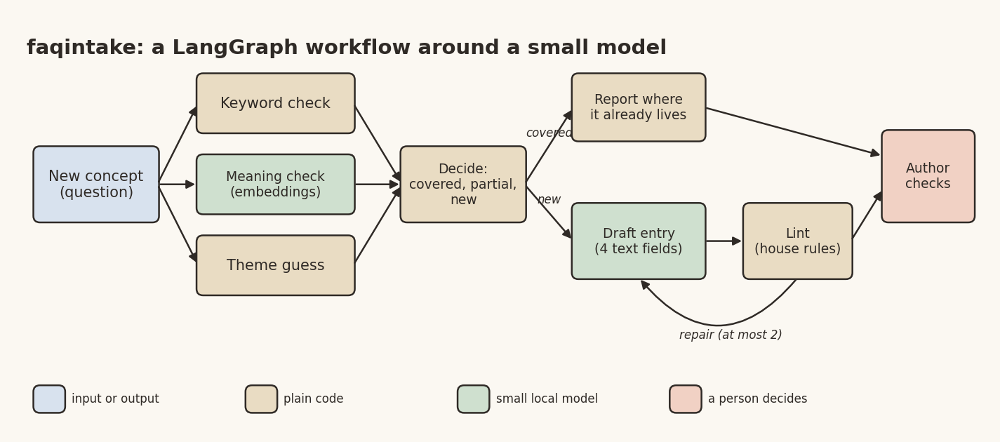

# A Small-Model Workflow That Lost to One Prompt, and Why I'm Glad It Did

*Frugal AI series, part 3 of 6. Desi Stack. DRAFT, publish Thu 5 Nov 2026.*

Banner: generate it from the prompt in `03_workflow_agent_linkedin.md` (title "Check before you write"), save it
as `03_workflow_agent_banner.png` in this folder, and put it at the top here before publishing.

I keep a set of FAQ notes for a book I'm writing about quantum computing. Each entry has a title, a question, an answer and a short paragraph on the common misconception. There are 36 of them so far.

Every time I learn something new, the same chores follow. Is this concept already covered somewhere? If it isn't, draft an entry in the house style. Check it against the house rules. List the other files that might need updating.

That's a workflow. So I built one with LangGraph and a small model running locally, and then measured it against the simplest alternative I could think of.

## The architecture



*Image file: 03_workflow_agent_diagram.png*

The new concept comes in as a question. Three checks run in parallel:

- a **keyword check**, reusing the regex counter I already had,
- a **meaning check**, comparing embeddings of the question with every existing entry,
- a **theme guess**, to suggest which of five themes the entry belongs to.

A decision step then routes the concept: covered, partly covered, or new. Covered concepts produce a report of where they already live. New ones go to a drafting sub-graph: pick a style example, ask the model for four text fields, lint the result against the house rules, and loop back for a repair at most twice.

The graph itself is a few lines (condensed from `faqintake/graph.py`):

```python
g = StateGraph(State)
for n in ("normalise", "regex_check", "semantic_check", "theme_check",
          "decide", "covered", "partial", "draft_flow", "plan", "render"):
    g.add_node(n, NODES[n])
g.add_edge(START, "normalise")
for n in ("regex_check", "semantic_check", "theme_check"):
    g.add_edge("normalise", n)                                   # fan out
g.add_edge(["regex_check", "semantic_check", "theme_check"], "decide")  # wait for all three
g.add_conditional_edges("decide", route,
                        {"covered": "covered", "partial": "partial", "new": "draft_flow"})
```

The design rule was the same as in every Frugal AI project. Plain code does the counting, the searching, the routing and the linting. The model writes only four text fields. The skeleton of the entry, the sources section and a closing "Unverified draft" line are written by code, so a draft can never claim to be verified, and a link appears only if I typed it.

One small but telling detail: removing dashes is also code. A prompt can't reliably stop a small model from writing them.

## Inputs and outputs

In: a new concept, as a question. Out: either "this is already covered, here", or a draft entry plus a report of the files that would need a change. Nothing is written into the real FAQ folder. I move a draft by hand after checking it.

## The half that worked

Duplicate detection worked very well. Given 20 reworded versions of existing questions, the meaning check found the right entry first every time. Deciding "covered or new" was right on most cases, with the threshold set on one half of the cases and tested on the other. The overlap is real, though: the most similar new concept scored higher than the least similar covered one, so a quarter of cases land in a "needs review" band, which is the honest outcome for neighbouring topics.

## The half that lost

For drafting, I compared the workflow with one plain, well-written prompt, on 12 entries, each time hiding the real entry and giving only its notes.

The plain prompt matched or beat the workflow on almost everything. It passed the lint just as often, stayed closer to the real entry, used a fifth of the tokens and took less than half the time. Worst of all, two thirds of the workflow's drafts contained a number that wasn't in my notes. The plain prompt's drafts had none.

The cause was visible in the drafts. The workflow showed the model the nearest existing entry as a style example, and the small model copied that entry's subject instead of my notes. Notes about QAOA circuit depth came back as an entry about quantum arithmetic. The invented numbers came from the example.

The fix I wrote is a fixed style example on a completely unrelated topic (engine sizes), so there's nothing worth copying. It's switched on and tested offline, but not evaluated yet, and I won't claim it works until it is.

## The lesson

A workflow earns each extra step only when you measure it against the simple baseline. More steps gave a small model more chances to go wrong. The parts that worked best were the ones where code did the deciding and the model did the least.

## Pick it up

- run the drafting evaluation with the neutral example,
- try a second, different small model for drafting,
- a meeting-notes version of the same skeleton,
- a short paper on when workflows help small models, and when a single prompt is enough.

Code: https://github.com/yogeshhk/FrugalAI/tree/main/code/workflow-agent

Next in the series: fine-tuning on a laptop CPU, a router that worked and a Marathi book that didn't stick.

*Tags: LangGraph, AI Agents, Small Language Models, Evaluation, Frugal AI*
