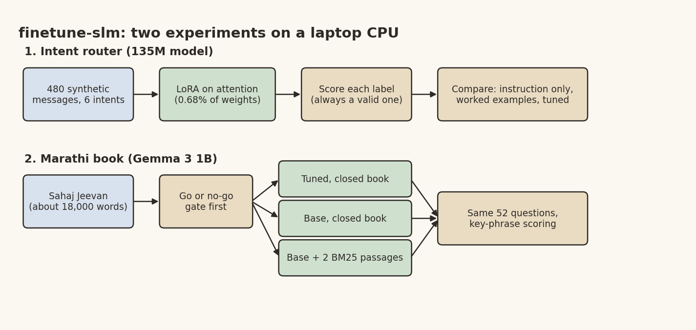

# Fine-Tuning on a Laptop CPU: A Router That Worked, a Marathi Book That Didn't Stick

*Frugal AI series, part 4 of 6. Desi Stack. DRAFT, publish Sat 7 Nov 2026.*

Banner: generate it from the prompt in `04_finetune_slm_linkedin.md` (title "Teach it small"), save it as
`04_finetune_slm_banner.png` in this folder, and put it at the top here before publishing.

"Can I fine-tune a language model without a GPU?" Students ask me this a lot. I wanted an answer with numbers, so I ran two experiments on an ordinary Windows laptop, CPU only.

## The architecture



*Image file: 04_finetune_slm_diagram.png*

## Experiment 1: a tiny router

The job: read a short message from a farmer's helpline and route it to one of six categories (weather, price, pest, scheme, repair, other). It's the kind of task that sits in front of a real service.

The model: SmolLM2, 135 million parameters. Small enough that training fits in minutes.

The data: 480 synthetic messages from templates, plus two test sets of 150 each. One reuses the training phrasings with new names, places and crops. The other uses phrasings the model never saw. An early version of the data leaked messages between train and test; a test caught it, and now a test asserts zero overlap.

The method: LoRA, which freezes the model and trains small adapter matrices. Here it trained 921,600 parameters, 0.68% of the model:

```python
from peft import LoraConfig, get_peft_model

cfg = LoraConfig(r=8, lora_alpha=16, lora_dropout=0.05, task_type="CAUSAL_LM",
                 target_modules=["q_proj", "k_proj", "v_proj", "o_proj"])
model = get_peft_model(model, cfg)
```

One design choice made the result reliable: the tuned model doesn't generate free text. It scores each of the six labels and picks the most likely one, so it can never return an invalid category.

Training took about 22 minutes on the CPU (while other jobs were also running), peaked at about 1.8 GB of memory, and produced an adapter of 3.7 MB.

The result: told only the label names, the untouched model was close to guessing. With worked examples in the prompt it improved, at more than twice the prompt length. The tuned model was the most accurate on both test sets, and it needed a prompt of about 18 tokens. On phrasings it had never seen, accuracy dropped a little, which is the honest cost of synthetic training data.

I'm careful about the claim here. A larger prompted model might do just as well, and that comparison is still open. What it does show is that for a narrow, stable task, a tiny tuned model on a laptop is a frugal choice.

## Experiment 2: can a model learn a book?

The harder question. Sahaj Jeevan is a Marathi book (34 chapters, about 18,000 words). Could a small model learn it well enough to answer questions with no lookup at all?

First, a go or no-go gate, fixed before looking at results: with the right passage in front of it, can the model read Marathi well enough to answer? Gemma 3 270M couldn't (fluent Marathi, but it echoed the question). Gemma 3 1B could. So 1B went forward.

Then three systems on the same 52 questions:
- the base model with no help (closed book),
- the model after three epochs of LoRA training on the book text and 80 question and answer pairs,
- the base model with the two best passages found by a plain BM25 keyword search.

Before measuring, I wrote down what I expected: retrieval would win on facts, and tuning would mostly change the style. That's what happened.

Tuning roughly doubled the closed-book score over the untouched model, but almost all the gain was on facts that were also in the training pairs. Facts that appeared only in the raw book text didn't stick, even after reading it three times. The base model with two retrieved passages answered more than twice as many questions as the tuned model.

Tuning did change one thing clearly: the answers became short, fluent and almost entirely in Devanagari, at a fraction of the prompt size. If you want that style and you get the facts from somewhere else, that's useful. For correctness on this book, it wasn't.

The training run needed about 7 GB of memory. The first attempt was stopped when the machine ran low, and the trainer now saves every 40 examples, resumes mid-epoch, and refuses to start without enough free memory. A sleeping laptop also suspended one epoch for 53 minutes. Practical things like that are in the README too.

## The lesson

Fine-tuning teaches style and narrow skills. Facts belong in retrieval. And a CPU is enough to find that out for yourself.

## Pick it up

- the comparison with a prompted Qwen3 1.7B on the router task,
- a tuned model that also reads retrieved passages (the obvious next experiment),
- quantising the tuned Marathi model for a phone,
- more Marathi and Hindi tasks, and a research paper on Indian-language small models.

Code: https://github.com/yogeshhk/FrugalAI/tree/main/code/finetune-slm

Next in the series: asking questions of your own notes, offline.

*Tags: Fine-Tuning, LoRA, Marathi, Small Language Models, Frugal AI*
