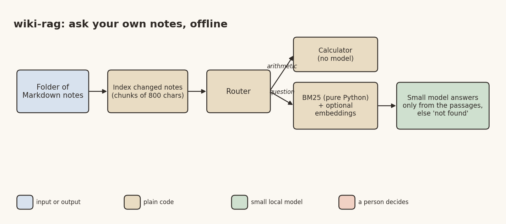

# Ask Your Own Notes, Offline: A Plain-Python Retriever and a Small Model

*Frugal AI series, part 5 of 6. Desi Stack. DRAFT, publish Mon 9 Nov 2026.*

Banner: generate it from the prompt in `05_wiki_rag_linkedin.md` (title "Ask your own notes"), save it as
`05_wiki_rag_banner.png` in this folder, and put it at the top here before publishing.

A lot of us keep notes in plain Markdown files: an Obsidian vault, a Logseq graph, or just a folder. The notes pile up, and finding something written two years ago gets harder every month.

I wanted the smallest useful thing that answers questions from your own notes, with nothing leaving the laptop. No cloud, no vector database to install, no GPU.

## The architecture



*Image file: 05_wiki_rag_diagram.png*

**Index.** Notes are split by heading and paragraph into chunks of at most 800 characters. A small manifest of file modification times means only new or changed notes are re-read, so re-indexing a large vault is quick.

**Route.** Plain arithmetic ("what is 12 times 7 plus 3?") goes to a safe calculator and never reaches the model. A small model is a poor calculator; code is a perfect one.

**Retrieve.** BM25, the classic keyword ranking, in a few dozen lines of plain Python (lightly trimmed from `wikirag/bm25.py`). It needs no model at all, so on an old laptop it costs almost nothing:

```python
class BM25:
    def __init__(self, docs_tokens, k1=1.5, b=0.75):
        self.k1, self.b = k1, b
        self.n = len(docs_tokens)
        self.lengths = [len(d) for d in docs_tokens]
        self.avg_len = sum(self.lengths) / self.n if self.n else 0.0
        self.tf = [Counter(d) for d in docs_tokens]
        df = Counter()
        for counts in self.tf:
            df.update(counts.keys())
        self.idf = {t: math.log(1 + (self.n - f + 0.5) / (f + 0.5)) for t, f in df.items()}

    def scores(self, query_tokens):
        out = [0.0] * self.n
        for term in set(query_tokens):
            idf = self.idf.get(term)
            if idf is None:
                continue
            for i, counts in enumerate(self.tf):
                f = counts.get(term, 0)
                if f:
                    denom = f + self.k1 * (1 - self.b + self.b * self.lengths[i] / self.avg_len)
                    out[i] += idf * f * (self.k1 + 1) / denom
        return out
```

Optionally, a small embedding model served by LM Studio adds meaning-based search, fused with BM25 by reciprocal rank fusion.

**Answer.** The top few chunks (about 2,400 characters at most) go to a small local model, Qwen3 1.7B, with one rule: answer only from these notes, or say you couldn't find it.

Hindi and Marathi words are tokenised as whole words, so the keyword search works for Devanagari notes too.

## Inputs and outputs

In: a folder of `.md` files and a question. Out: an answer with the source note, or "not found". The index is a single JSON file inside the vault, safe to delete.

```bash
python -m wikirag index my_vault
python -m wikirag ask my_vault "Which coach and seat is my train ticket for?" --model qwen/qwen3-1.7b
python -m wikirag watch my_vault --interval 5      # re-indexes when notes change
```

## What measuring showed me

I built a test vault of made-up notes with known facts, and three kinds of questions: some that reuse the note's exact words, some that ask the same thing in different words, and some whose right answer is "it's not in your notes".

When the question used the note's own words, keyword search found the right note essentially every time. When I asked in different words, keyword search missed most of them. That's exactly where the small embedding model earns its place: it catches the meaning, and it found most of the reworded questions.

The surprise: mixing keyword and meaning search didn't beat meaning search alone on reworded questions. The keyword side added noise there. With only 32 such questions, I wouldn't read much into the gap, but it's a reminder that "hybrid search" isn't automatically better.

Keyword search took under a millisecond per question. The embedding call took a couple of seconds on a busy machine.

The honest limit: the test vault is small and made up. Scoring the model's answers, and a test on a real, larger vault (with the owner's consent), are still to do. The numbers say the pipeline works, not how it performs on your notes.

## The lesson

Start with the cheapest retriever that could work, measure it on questions that don't share your words, and add the heavier piece only where the measurement says it pays.

## Pick it up

A good first project for a student:
- a Marathi and Hindi notes vault with its own question set,
- scoring the answers, not just the retrieval,
- a comparison with the structured approach from the quantum-wiki story,
- running it on a Raspberry Pi.

Code: https://github.com/yogeshhk/FrugalAI/tree/main/code/wiki-rag

Next in the series: speaking a form in Marathi or Hindi.

*Tags: RAG, BM25, Obsidian, Personal Knowledge Management, Frugal AI*
