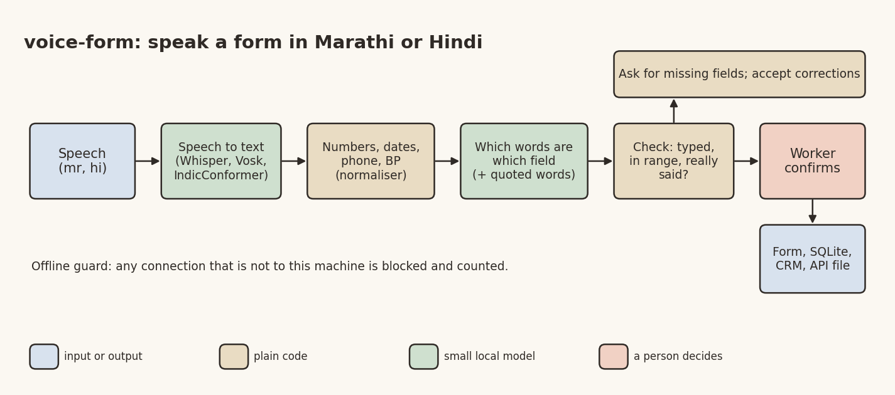

# Speak the Form: Filling Forms in Marathi and Hindi, Offline

*Frugal AI series, part 6 of 6. Desi Stack. DRAFT, HOLD: publish only after the demo runs on the author's real
recordings, after the Game Theory book window (late Nov or early Dec 2026). Rewrite "What I found" from
`code/voice-form/results/RESULTS.md` before publishing.*

Banner: generate it from the prompt in `06_voice_form_linkedin.md` (title "Speak the form"), save it as
`06_voice_form_banner.png` in this folder, and put it at the top here before publishing.

An ASHA worker finishes a home visit with a pregnant woman. Now she has to fill a form: name, age, village, weeks of pregnancy, blood pressure, weight, haemoglobin, tablets given, next visit date. On a small phone. Often in a second language. Often standing in a doorway.

She could say it all in twenty seconds:

> रेखा जाधव, वय एकोणतीस, गाव शिरूर. मोबाईल नंबर नऊ आठ दोन तीन चार पाच सहा सात आठ नऊ. सोळा आठवडे पूर्ण झाले. हिमोग्लोबिन साडे दहा आहे. लोहाच्या तीस गोळ्या दिल्या.

So the fifth Frugal AI project asks: can a laptop with no internet turn that into a filled form?

## The architecture



*Image file: 06_voice_form_diagram.png*

**Speech to text.** A small offline speech model writes down what was said. The backends are swappable behind one interface: Vosk (a 42 MB Hindi model), Whisper fine-tuned for Marathi or Hindi, and AI4Bharat's IndicConformer, which covers 22 Indian languages.

**Plain code for everything code does well.** Speech engines write numbers both ways, and small models fumble them. So a normaliser turns spoken Marathi and Hindi numbers into digits, reads "एकशे चाळीस बाय नव्वद" as a blood pressure of 140/90, joins a phone number said digit by digit, and understands dates like "बारा नोव्हेंबरला" or "उद्या". It's tested line by line.

```python
>>> normalize_text("बीपी एकशे चाळीस बाय नव्वद, हिमोग्लोबिन साडे दहा")
'बीपी 140 बाय 90 हिमोग्लोबिन 10.5'
```

**A small model only for "which words are which field".** Qwen3 1.7B or Gemma 2 2B, running in LM Studio on the same laptop, gets the form definition and the normalised text, and must return each value with the exact words it came from. A JSON schema constrains its output.

**Code checks every value.** Types and ranges are checked (an age of 9 on an antenatal form is flagged). Then the value itself must be found in what was said: the number, the digits, the date, the option word. A value the code can't find was invented, so it's dropped. Phone numbers, blood pressure and voter-ID numbers are read by code first, with the model only as a fallback.

The idea, simplified from `record.py`:

```python
def grounded(spec, value, text, today=None) -> bool:
    """Plain-code check that a parsed value was actually said."""
    ...
    if spec.type in ("int", "float"):
        return nz._fmt(float(value)) in tokens_of(text)
    if spec.type == "date":
        return any(parse_date(chunk, today) == value for chunk in windows(text))
    ...
```

**A person confirms.** Missing fields turn into spoken-style follow-up questions ("कृपया किती आठवडे झाले सांगा"), corrections like "वय बत्तीस करा" are merged, and nothing is saved until the worker confirms. Then the record goes to any of four local sinks: a form file, SQLite, a CRM-style contact, or an API payload that is written down and never sent.

An offline guard blocks and counts every network connection that isn't to the laptop itself. The demo shows the counter: zero.

## One form is one file

The same pipeline fills three forms: the ASHA antenatal visit, a simplified electoral-roll enumeration form for a booth-level worker, and a field-service ticket for a technician. A new form needs no code, only a YAML file:

```yaml
- name: weeks_pregnant
  type: int
  required: true
  min: 1
  max: 42
  label: Weeks of pregnancy
  label_mr: किती आठवडे झाले
  label_hi: कितने हफ्ते हुए
```

## What I found

[REWRITE FROM THE REAL RESULTS: extraction on the script text (rules only against the two small models, before and
after the fixes, tune and held-out), speech-to-text WER per backend and language on the author's recordings, the
end-to-end field accuracy, the speed per utterance on the laptop, and at least one thing that did not work (for
example: translating to English first turned names into English spellings and lost badly).]

## The honest limits

Everything here is synthetic: made-up names, villages and numbers, read by one speaker. It says nothing yet about other accents, dialects or a real doorway's noise. The ASHA form is data entry only. The app gives no advice, no diagnosis and no dosing. None of the three forms is an official government form.

## Pick it up

- an Android version (whisper.cpp or sherpa-onnx for speech, llama.cpp for the model, the same YAML forms),
- recordings from many speakers, with consent, and real field noise,
- more forms: ration cards, school attendance, grievance desks,
- a paper on field extraction from code-mixed Marathi and English speech, separating the ear's errors from the understanding's.

Code: https://github.com/yogeshhk/FrugalAI/tree/main/code/voice-form

*Tags: Speech Recognition, Marathi, Hindi, Digital Public Goods, Frugal AI*
