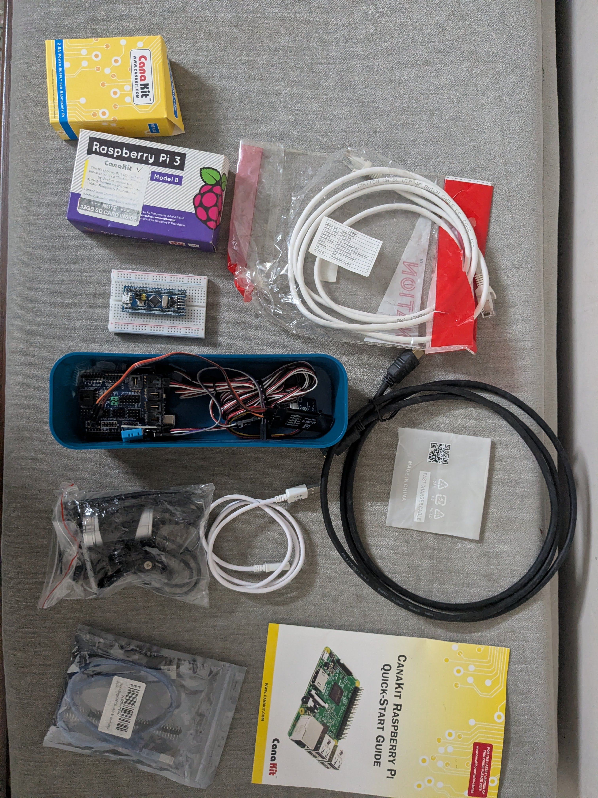
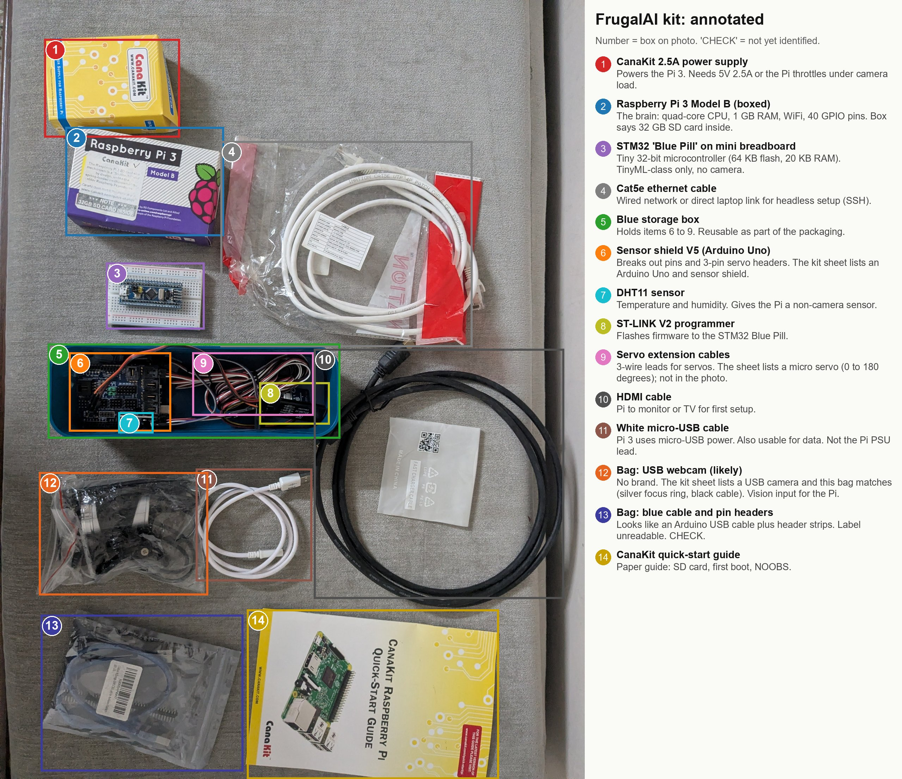
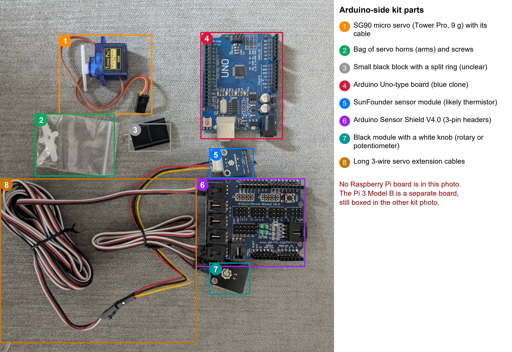
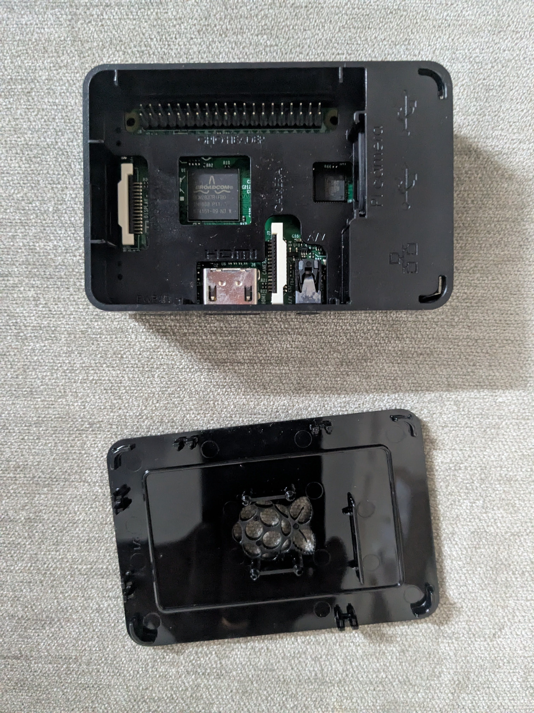
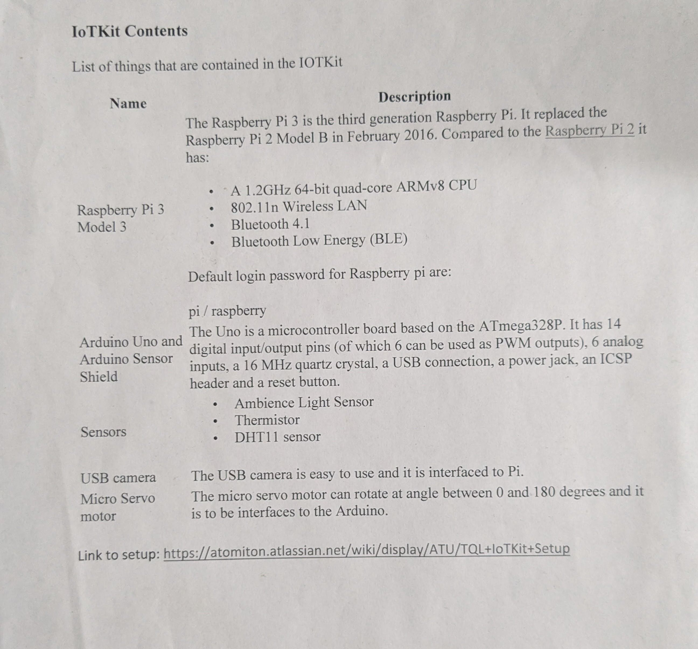

# Hardware kit: what we have, what is missing, what we can build

Analysis report. Status: draft for the author's review. Nothing here has been run on the kit yet, so every
performance statement is "pending" until a script produces a number on a named device. Spec figures quoted from
memory are tagged "(to verify)".

## The kit photo



*Image file: images/frugalai-kit-original.jpg*

## The kit, annotated



*Image file: images/frugalai-kit-annotated.jpg*

The legend beside the photo gives the name and use of each boxed item. The "Inventory" table below repeats it in words.

## The Arduino side, close-up



*Image file: images/frugalai-arduino-kit-annotated.jpg*

This close-up shows the Arduino side of the kit only. It contains no Raspberry Pi. Items 3, 5 and 7 in the legend are best guesses (to verify).

## The Pi 3, found

The kit photo above shows only the CanaKit box. The author has since found a Raspberry Pi 3 at home, inside a black
two-part case. The base is off, but the case shell could not be removed, so the bare board is not yet photographed.
The shell has openings for the chip, the ports and the ribbon connectors, so a lot can be read already.



*Image file: images/frugalai-rpi3_with_cover.jpg*

| What the photo shows | Reading |
|---|---|
| Chip marking "BROADCOM BCM2837..." (the rest is partly legible) | The Pi 3 Model B SoC. The Pi 3 B+ uses a different part (BCM2837B0) under a metal cap; this chip has none. Consistent with a Pi 3 Model B. Confirm from the text printed on the board. |
| 40-pin GPIO header, labelled "GPIO HEADER" on the case | Free for sensors, LEDs, servos and the DHT11. |
| DISPLAY (DSI) and CAMERA (CSI) ribbon sockets, both open through the case | A CSI camera can plug in with the case on, so the case may already meet the "case that exposes the CSI port" need. Check that a ribbon cable fits through the gap (to verify). |
| Full-size HDMI, 3.5 mm A/V jack, USB and Ethernet icons, microSD and power labels on the case | Matches the Pi 3 Model B layout. The kit HDMI cable is full size, so it fits. |
| A second square chip near the USB side | Most likely the USB and Ethernet controller (to verify). |
| Removed piece with a raspberry-shaped vent grille | The case base or cover. The case looks like the official Raspberry Pi 2 and 3 style (to verify). |

Not yet known: the revision printed on the board, whether a microSD card is in the slot (the slot is under the board),
and whether the board is held by the base or by the shell. Do not force the shell; see `pi-checklist.md`.

## Inventory (what we have)

| Tag | Item | What it does for us | Confidence |
|---|---|---|---|
| power | CanaKit 2.5A power supply (boxed) | Powers the Pi 3. Under-powering causes throttling during camera inference. | Read from box |
| pi | Raspberry Pi 3 Model B (found, in a black case; the CanaKit box is separate) | The edge computer: quad-core ARM CPU, 1 GB RAM, WiFi, Bluetooth, 40 GPIO pins, CSI camera port, no GPU worth using for ML (to verify). Box note says a 32 GB SD card came with it; whether a card is in the slot is not yet checked. | SoC marking read from the photo; revision still to read |
| bluepill | STM32 "Blue Pill" on a mini breadboard | Small 32-bit microcontroller, about 64 KB flash and 20 KB RAM (to verify). TinyML-class only. Cannot run vision. | Visually clear |
| stlink | ST-LINK V2 programmer | Flashes firmware onto the Blue Pill. | Text readable |
| shield | Sensor shield V4.0 on an Arduino Uno | Breaks out pins and 3-pin servo headers. "Arduino Sensor Shield V4.0" is printed on the board in the close-up photo. The kit sheet lists an Arduino Uno and sensor shield. The Uno-type board (blue, probably a clone) is visible in the close-up. | Printed text (close-up) and kit sheet |
| dht11 | DHT11 sensor | Temperature and humidity. A cheap non-camera input. | Visually clear |
| servo | Servo extension cables | 3-wire leads for servos (pan-tilt, latch, pointer). The servo itself is not in the kit photo; the close-up shows a Tower Pro SG90 micro servo (9 g) with a bag of horns. | Visually clear; SG90 text readable in the close-up |
| bluebox | Blue storage box | Holds shield, DHT11, ST-LINK and cables. | Visually clear |
| eth | Cat5e ethernet cable | Wired link for headless setup over SSH. | Read from print |
| hdmi | HDMI cable | First-boot display. | Visually clear |
| usb | White micro-USB cable | Pi 3 power connector is micro-USB. Can also carry data. | Visually clear |
| guide | CanaKit quick-start guide | Paper first-boot guide. | Read from print |
| bag-a | Bag with silver rings and black parts | Most likely the USB webcam the kit sheet lists (no brand visible). Confirm by plugging it in. | Medium |
| bag-b | Anti-static bag with blue cable and pin headers | **Unidentified.** Looks like a USB cable plus header strips. Label unreadable. Open and check. | Low |

## Kit contents sheet

The author found the original kit list. It settles several questions the photo could not.



*Image file: images/Atomiton_kit_list.jpg*

| On the sheet | Meaning for us |
|---|---|
| Raspberry Pi 3 Model 3 (sic) | The Pi 3 Model B in the photo. The sheet gives a 1.2 GHz 64-bit quad-core CPU, 802.11n WiFi and Bluetooth 4.1 with BLE. |
| Arduino Uno and sensor shield | Confirms the board under the shield. The Uno is an ATmega328P board with 14 digital pins. Good for sensors and servos, no vision. |
| Sensors: ambience light, thermistor, DHT11 | The DHT11 is identified in the kit photo. The close-up shows a SunFounder sensor module that is most likely the thermistor (to verify) and a black module with a white knob that is not yet named (to verify). The ambient light sensor is not yet identified; locate it. |
| USB camera | The vision input. It is a plain webcam with no brand visible, so bag-a is most likely it. |
| Micro servo motor (0 to 180 degrees) | The close-up shows a Tower Pro SG90 micro servo (9 g) with its horns, and the extension cables are in both photos. The 0 to 180 degree range is the sheet's claim. |

Not on the sheet, so added to the kit later or kept from elsewhere: the STM32 Blue Pill, the ST-LINK V2 and the mini
breadboard. The sheet points to an internal setup page; it is not needed here. The sheet also quotes the Pi's factory
login. Change that password before the Pi joins any network.

Still unknown: what the webcam is exactly (resolution, built-in microphone), and what bag-b holds.

## What the kit is good for

The Pi 3 Model B is the only item here that can run a vision model. Everything else supports it.

| Tier | Device | Role | Camera ML? |
|---|---|---|---|
| Laptop | Old Dell, CPU only | Train, export and quantize models. Work lives in `code/common/devices/old-dell.md`. | Train only |
| Edge computer | Pi 3 Model B (have) | Runs the deployed model with a camera. 1 GB RAM forces small models and low resolution. | Yes, small models |
| Edge computer, upgrade | Pi 4 (not planned) | Same recipes, more headroom. | Yes, comfortable |
| Microcontroller | Blue Pill, Arduino (have) | Sensors, servos, relays. TinyML on sensor data, not images. | No |
| Camera microcontroller | ESP32-CAM or similar (buy, optional) | Very low power, very small models, tiny images. | Yes, tiny |

The Pi 3 is a good teaching device because it is a hard target: if a recipe works there, it works on anything newer.
That is the frugal position. The honest limit is speed; the frame rate on the Pi 3 for each model is pending until
the benchmark runner measures it.

### Reading the Gemini write-up against our kit

The pasted write-up is a sound general overview, but it assumes a Pi 4 or 5, so apply it with care.

| Gemini says | Our position |
|---|---|
| Use a Pi 4 or 5 | We own a Pi 3. Start there, record the real numbers, and treat Pi 4 or 5 as an upgrade. |
| Classic Arduino cannot do vision | Agreed. Our Arduino and Blue Pill are sensor and actuator boards here. |
| Edge Impulse for no-code training | Useful for learning, but it trains in the cloud and uploads your images. This repo is offline-first and the people-counting data is sensitive, so prefer local training. Fine as a comparison later. |
| Start from MediaPipe or YOLO pre-trained models | Agreed for the starter. MediaPipe gesture models suit the gesture project. |
| Quoted frame rates and resolutions | Not used. No number is stated until we measure it. Its sources are mostly video and shop blogs, which this repo does not cite. |

## What is missing (to buy or confirm)

Ordered by what unblocks the first camera project. Prices are not listed: check local sellers on the day.

| Priority | Item | Why | Notes |
|---|---|---|---|
| Partly done | Camera for the Pi: the kit's own USB webcam did not open on the Dell laptop (untested on the Pi); a second USB webcam works at low resolutions on the laptop. See `code/gesture-switch/README.md` | No camera, no vision. | USB needs no ribbon and is easy to swap, but costs a little more CPU than a CSI module on the Pi 3. |
| Must | microSD card reader for the laptop | Flash Raspberry Pi OS. | Probably already owned. Confirm. |
| Should | Heatsinks and a camera mount | The Pi 3 throttles when hot (to verify) and the camera needs a fixed position. | The Pi already has a case that exposes the CSI port, so only a mount is needed. Check first whether a small heatsink fits the chip window of that case (to verify). |
| Should | Male-to-female and male-to-male jumper wires | Connect sensors, LEDs, servos. | Only a few are in the kit. |
| Should | USB power bank, 5V and at least 2.5A | A portable demo that is not tied to a wall. | Cheap power banks sag under load; test with the throttle check. |
| Should | USB microphone and a small speaker | The voice-form project on the Pi. | Skip if the voice project stays on the laptop. |
| Nice | 0.96 inch I2C OLED display | Shows counts or status without a monitor. | Cheap, tiny, good for the people-counter. |
| Nice | LEDs, buzzer, relay module, PIR sensor, push buttons | Physical output for gesture and counting recipes. | A starter electronics assortment covers it. |
| Nice | One more small servo | Pan-tilt camera mount (two axes), or a pointer. | The kit has one SG90 and the extension cables. A pan-tilt mount needs two servos. |
| Later | Pi 4 with the right power supply | More headroom for heavier models. | Do not buy until the Pi 3 limits are measured. |
| Later | ESP32-CAM | The microcontroller tier for vision. | Separate learning track, not needed first. |

## Packaging: how to put it in a box

Goal: the kit travels, a stranger can set it up from the lid, and each project has its parts together.

Principles:
- One lidded box for the **core kit** (Pi, power, SD, camera, cables). Everything for a project is reachable without unpacking the rest.
- Small parts in labelled zip bags or a divided tray. Boards in anti-static bags.
- A card inside the lid with the setup steps and the project recipe name. Use a printed card, not memory.
- Separate **dev kit** (breadboards, sensors, programmer) from the **field unit** (Pi in a case with camera, power, nothing loose). The field unit is what you demo and leave behind.

Suggested layout of the core box, seen from above:

```
+--------------------------------------------------+
| Lid card: setup steps, recipe name, WiFi note    |
+--------------------------------------------------+
|  [ Pi 3 in case + heatsinks + camera ]  [ PSU ]  |
|  [ SD card spare + reader ]   [ micro-USB, HDMI ]|
|  [ ethernet cable, coiled ]                      |
|  [ Bag: jumper wires ]  [ Bag: LEDs, buzzer ]    |
|  [ Blue box: shield, DHT11, ST-LINK, servo leads]|
|  [ Anti-static: Blue Pill on breadboard ]        |
+--------------------------------------------------+
```

The existing blue box can stay as the sensors-and-programmer module inside the larger box. Choose a lidded plastic
box large enough for the Pi case, power supply and the blue box, with a foam or egg-crate insert so boards are not
loose. Label every bag with the item name. This is a plan, not a purchase: nothing is bought until you decide.

## Projects the kit can support

### Recommended starters (pick these first)

**Gesture switch: a hand-gesture command board** (vision, uses the Pi and camera)
- Camera sees a hand, a pre-trained model classifies the gesture, and the Pi acts: LED, buzzer, servo or a spoken phrase.
- Social angle: a non-verbal call-for-help or yes/no board for a patient or a person who cannot speak or type. It is the visual twin of the voice-form project: voice for people who can speak, gesture for those who cannot.
- Why first: a pre-trained model exists, so the first success needs no training. Then it teaches the whole pipeline when you add your own gesture.
- Needs: Pi 3, camera, LED or buzzer, optional servo. All covered except the camera.

**People counter for a waiting room or gate** (vision, adds the DHT11)
- Count people crossing a line or present in view, log counts and room temperature and humidity (DHT11) to a local file. Show the live count on an OLED or a local web page.
- Social angle: crowding and ventilation in a clinic or school room, with privacy by design: only the count is stored, frames are discarded in memory and never saved.
- Why second: it adds detection, tracking, a sensor and logging, and forces the privacy decision.
- Needs: Pi 3, camera, DHT11 (have), OLED (optional).

Together these two walk the full edge-AI loop once each: pick a model, deploy, measure, wrap, and then, with a
custom gesture, collect data, train, export, quantize and redeploy.

### Further ideas (each needs a small addition)

| Idea | Type | What is needed | Social use |
|---|---|---|---|
| Voice form on the Pi | Voice | USB microphone, optional speaker | Fill forms by speaking, offline |
| Hand-hygiene or mask check | Vision | Camera, small classifier | Clinics, kitchens |
| Plant leaf health check | Vision | Camera, locally trained classifier | Small farms, home gardens |
| Seat or bed occupancy | Vision | Camera, PIR | Waiting rooms, shelters |
| Classroom attention-free attendance counter | Vision | Camera | Counts only, no faces stored |
| Environment logger with anomaly alert | Sensor | DHT11 (have), small model | Storage rooms, vaccine fridges (decision support only) |
| Sign-language letter recognizer | Vision | Camera, custom data | Accessibility |
| Door or pump controller by gesture | Vision + actuator | Relay, servo | Hands-free control |
| Medicine pill-box reminder | Sensor + voice | Speaker, buttons | Elderly care |
| Microcontroller keyword or motion trigger | TinyML | Blue Pill, ST-LINK (have) | Always-on, near-zero power |

Health ideas follow `docs/safety.md`: decision support only, never diagnosis.

## Starting a vision project: the recipe

A project is a self-contained folder under `code/`, copied from `code/_template/`. `code/gesture-switch/` exists as a
stub; `code/people-counter/` is not yet created. Each recipe records the same things so results compare:

1. **Question.** One sentence: what does the unit decide, for whom.
2. **Device.** Named device, power source, camera, resolution and thread count.
3. **Model.** Pre-trained model first. Name, source, licence, file size.
4. **Run on laptop.** Prove the logic with a webcam on the Dell before touching the Pi.
5. **Deploy to the Pi.** Copy the model, run headless, offline. No cloud call at runtime.
6. **Measure.** Use the shared runner in `code/common/frugalai_common/`: frames per second, latency, CPU temperature, memory, power if a meter is added. A number counts only when a script produced it on a named device.
7. **Wrap.** A start script that runs at boot, a README with the wiring, and a lid card for the box.
8. **Own data (second pass).** Collect your own examples, train on the laptop, export, quantize, redeploy and compare against step 6.

### Starting the Pi, in order
1. Flash a 64-bit Raspberry Pi OS Lite with the official imager, enable SSH, set WiFi.
2. Boot, connect over ethernet or WiFi, update packages.
3. Connect the camera, confirm it works with the bundled camera tools (to verify the tool name for the OS version in use).
4. Create the project conda or virtual environment as the repo rules require; on the Pi itself use whatever the recipe documents, since conda on a Pi 3 is not practical (to verify).
5. Run the laptop-proven script on the Pi, then log the first benchmark row.

## Model and software choices for the Pi 3

All are candidates; none is chosen until benchmarked.
- **Hand and gesture:** MediaPipe hand or gesture models.
- **People detection:** a nano-sized detector exported to a lightweight runtime such as TFLite or ONNX Runtime, or NCNN.
- **Own classifier:** a small CNN or a pre-trained mobile network fine-tuned on laptop CPU, then quantized. See `docs/finetuning-on-cpu.md`.
- **Image handling:** OpenCV.
- **Optional comparison:** no-code tools such as Edge Impulse, kept as a comparison only because of the cloud upload.

## Risks and caveats
- The Pi 3 has 1 GB RAM. Large models will not fit; expect low resolution and few frames per second (pending).
- One bag (bag-b) is still unidentified, and the bag-a webcam is not yet confirmed by plugging it in.
- Camera data is personal. The people-counter must not store frames; state this in its README.
- Claims about specific boards (RAM, flash, accelerator support) come from memory and are tagged "to verify". Add each to `docs/sources.md` with a primary source before relying on it.
- No benchmark number exists for this kit.

## Open decisions for the author
- Free the Pi 3 from its case shell without force, then photograph the bare board top-down and from the underside, and read the revision text.
- Check whether a microSD card is in the slot, and what it holds, before the first boot.
- Plug in the webcam and record its resolution and whether it has a microphone.
- Open bag-b and tell me what it holds.
- Locate the ambient light sensor listed on the sheet. Confirm that the SunFounder module is the thermistor and say what the black knob module is. The micro servo is found (SG90).
- Gesture switch first, people counter first, or both in parallel.
- Whether to create `code/people-counter/` from the template.
- A power meter: see `upgrade-report.md`.
